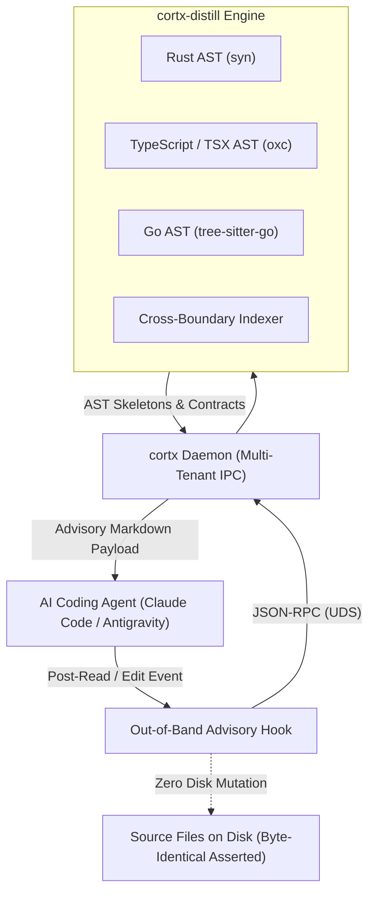

# Cortx

[](https://ringzerosystems.com)
[](./LICENSE)
[](./LICENSE-COMMERCIAL.md)
[](Cargo.toml)

> **Compiler-Aware Context Distillation & Out-of-Band Ground-Truth Injection for AI Coding Agents**

`cortx` is an ultra-fast, multi-tenant context distillation engine and background daemon built in Rust. It eliminates context dilution, attention decay, and file desynchronization when deploying AI coding assistants (Claude Code, Antigravity, OpenCode, Cursor) on large-scale polyglot codebases (>1.2M LOC).

---

## The Core Problems in Large-Scale AI Development

When AI coding agents operate on enterprise monorepos, two systemic failure modes emerge:

1. **Context Window Dilution & Semantic Drift:**
   Dumping raw implementation bodies into an LLM context window causes severe attention degradation. The model loses track of trait bounds, implicit interface contracts, and cross-boundary types defined thousands of lines or dozens of files away.
2. **Patch Tool Desynchronization:**
   Naive pre-read or post-read hooks inject comments, annotations, or synthetic types directly into files on disk. This mutates byte offsets and line numbers, causing subsequent patch and diff editing tools to fail with offset mismatches.

`cortx` solves both problems by pairing sub-millisecond AST skeleton distillation with **strictly non-destructive, out-of-band context delivery**. Target source files remain 100% byte-identical on disk at all times.

---

## Key Capabilities

- **Sub-Millisecond AST Distillation (`cortx-distill`):**
  - **Rust (`syn` / `quote`):** Strips function/method bodies down to `/* implementation omitted */` while preserving trait definitions, visibility, struct/enum layouts, and doc comments.
  - **TypeScript & TSX (`oxc_parser`):** Ultra-fast distillation stripping function bodies, React hook internals (`useEffect`, `useState`), and JSX elements down to clean type signatures and exported contracts.
  - **Go (`tree-sitter-go`):** Strips function and method bodies down to type signatures and automatically resolves implicit structural interface satisfaction across value $\mathcal{M}(T)$ and pointer $\mathcal{M}(*T)$ receiver method sets.
- **Strictly Non-Destructive Advisory Hooks (`cortx-daemon`):**
  - Delivers AST skeletons, contracts, and call hierarchies **exclusively out-of-band** (via stdout or Unix domain socket JSON-RPC).
  - Target files on disk are asserted byte-identical before and after tool hook execution, guaranteeing zero offset drift for agent diff tools.
- **Cross-Boundary Contract Indexing:**
  - Correlates backend Go and Rust HTTP routes (Gin, Chi, Echo, `net/http`) and data models with frontend TypeScript client `fetch` calls and consumer interfaces.
- **Multi-Tenant Daemon with Copy-on-Write Worktree Indexing:**
  - High-throughput background service (`$XDG_RUNTIME_DIR/cortx/daemon.sock`) servicing all active repositories and agent sessions.
  - Lazily indexes workspaces on first touch, reuses base repository symbol graphs via Copy-on-Write overlays for linked Git worktrees, and tracks RSS heap memory in Megabytes.
- **Interactive TUI Configurator:**
  - Terminal-native configuration interface for scoping project namespaces, inspection depths, and advisory ratios without manual TOML editing.

---

## Architecture



---

## Context Amplification & Search Elimination

In large codebases, AI coding assistants don't just fail from reading one large file—they fail from **exploratory context bloat**. To understand a single function or struct, an agent typically initiates a cascade of 5 to 15 recursive file reads and `grep` sweeps across the repository, filling the context window with thousands of lines of unrelated implementation logic.

`cortx` inverts this pattern:

- **Single-Turn Topological Awareness:** When the agent touches a target file, the advisory hook injects its AST skeleton, trait/interface contracts, call hierarchy, and cross-boundary routes out-of-band in sub-milliseconds.
- **Eliminating Exploratory Greps:** The agent receives exact upstream contracts and downstream caller sets immediately, eliminating the need to read entire dependent files just to inspect signatures.
- **Focused Distillation on Demand:** When agents or scripts invoke `cortx distill <FILE>`, the engine strips implementation bodies on the fly, emitting only compilable structural contracts.

---

## Sub-Millisecond AST Performance

Because `cortx` is written in Rust using native, memory-efficient parsers, context extraction executes entirely within sub-millisecond budgets without adding perceptual delay to agent tool calls:

| Parser Engine | Implementation | Target Languages | Processing Latency |
| :--- | :--- | :--- | :--- |
| **Rust AST Visitor** | `syn` / `quote` | `.rs` | `< 0.5 ms` |
| **JS/TS Parser** | `oxc_parser` / `oxc_allocator` | `.ts`, `.tsx`, `.js`, `.jsx` | `< 0.3 ms` |
| **Go Structural Resolver** | `tree-sitter-go` | `.go` | `< 0.4 ms` |
| **Cross-Boundary Indexer** | AST Route & Interface Correlator | Go routes $\leftrightarrow$ TS interfaces | `< 1.2 ms` |

---

## Installation & Quick Start

### Building from Source

```bash
# Clone the repository
git clone https://github.com/ringzerosystems/cortx.git
cd cortx

# Build release binaries
make build

# Install into your Cargo binary directory (~/.cargo/bin)
make install
```

### CLI Invocations

```bash
# Distill a Rust file down to its type skeleton
cortx distill src/engine.rs

# Distill a TypeScript / TSX component (strips JSX and hook internals)
cortx distill frontend/src/Dashboard.tsx

# Distill a Go service with implicit interface resolution
cortx distill backend/pkg/service/user.go

# Discover cross-boundary impact between backend routes and frontend types
cortx distill backend/pkg/routes/users.go --cross-boundary

# Start the background multi-tenant daemon
cortx daemon

# Query running daemon status, active workspaces, and memory telemetry
cortx daemon --status

# Launch interactive TUI configuration
cortx tui
```

---

## Agent Integration

### Claude Code (`.claude/config.json`)

Configure `cortx` as an out-of-band advisory post-read hook. Target files remain completely untouched on disk:

```json
{
  "hooks": {
    "post_read": "cortx daemon --hook-post-read --file $FILE_PATH"
  }
}
```

---

## System Configuration (`cortx.toml`)

`cortx` uses a centralized, declarative configuration model loaded from `$XDG_CONFIG_HOME/cortx/cortx.toml` or `~/.config/cortx/cortx.toml` with strict working directory isolation:

```toml
[daemon]
system_daemon = true                  # Multi-tenant mode servicing all workspaces
lazy_indexing = true                  # Defers AST indexing until first touch on workspace
idle_ttl_secs = 7200                  # Unindexes idle workspaces after 2 hours
enable_file_watcher = true            # Background notify file watcher across active repos
workspace_logging = true              # Isolated logs under <log_dir>/workspaces/<project>.log

[projects.acme-platform]
qualified_path = "/home/user/projects/acme-platform"
has_worktrees = true                  # Enables Copy-on-Write overlay indexing for Git worktrees
lang = ["rust", "typescript", "go"]
watch_paths = ["crates", "frontend/src", "backend"]
ignored_dirs = [".git", "target", "node_modules", "dist"]

[projects.acme-platform.cross_boundary]
rust_models = "crates/shared-types/src"
go_routes = "backend/pkg/api"
ts_types = "frontend/src/types"
```

---

## Verification & QA

`cortx` enforces strict compiler and modularity guarantees across all workspace crates:

```bash
make qa        # Full QA gate: fmt-check -> clippy (-D warnings) -> deny -> machete -> loc
make test      # Workspace unit and integration tests
make bench     # Criterion microbenchmarks for AST distillation parsers
```

---

## License & Commercial Use

Copyright &copy; 2026 Mark Horila / RingZero Systems LLC.

`cortx` is dual-licensed:

1. **Open Source ([AGPL-3.0](./LICENSE)):** Free for open-source development, academic evaluation, and workflows that comply with the GNU Affero General Public License v3.0.
2. **Commercial License ([LICENSE-COMMERCIAL.md](./LICENSE-COMMERCIAL.md)):** Organizations deploying, embedding, or modifying `cortx` in proprietary commercial environments or hosted internal developer platforms without AGPL-3.0 copyleft obligations may obtain a commercial license from **RingZero Systems LLC**.

For commercial licensing, enterprise pilots, or custom AST/compiler integration sprints, contact:

- **Web:** [https://ringzerosystems.com](https://ringzerosystems.com)
- **Direct:** `licensing@ringzerosystems.com`
