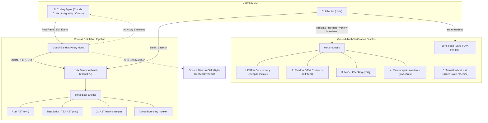

# Cortx Architecture & Internal Design

`cortx` pairs sub-millisecond AST skeleton distillation with strictly non-destructive, out-of-band context delivery and ground-truth verification oracles.

---

## The Core Problems in Large-Scale AI Development

When AI coding agents operate on enterprise monorepos, two systemic failure modes emerge:

1. **Context Window Dilution & Semantic Drift:**
   Dumping raw implementation bodies into an LLM context window causes severe attention degradation. The model loses track of trait bounds, implicit interface contracts, and cross-boundary types defined thousands of lines or dozens of files away.
2. **Patch Tool Desynchronization:**
   Naive pre-read or post-read hooks inject comments, annotations, or synthetic types directly into files on disk. This mutates byte offsets and line numbers, causing subsequent patch and diff editing tools to fail with offset mismatches.

`cortx` solves both problems by pairing sub-millisecond AST skeleton distillation with **strictly non-destructive, out-of-band context delivery**. Target source files remain 100% byte-identical on disk at all times.

---

## High-Level Architecture

---

## Context Amplification & Search Elimination

In large codebases, AI coding assistants don't just fail from reading one large file—they fail from **exploratory context bloat**. To understand a single function or struct, an agent typically initiates a cascade of 5 to 15 recursive file reads and `grep` sweeps across the repository, filling the context window with thousands of lines of unrelated implementation logic.

`cortx` inverts this pattern:

- **Single-Turn Topological Awareness:** When the agent touches a target file, the advisory hook injects its AST skeleton, trait/interface contracts, call hierarchy, and cross-boundary routes out-of-band in sub-milliseconds.
- **Eliminating Exploratory Greps:** The agent receives exact upstream contracts and downstream caller sets immediately, eliminating the need to read entire dependent files just to inspect signatures.
- **Focused Distillation on Demand:** When agents or scripts invoke `cortx distill <FILE>`, the engine strips implementation bodies on the fly, emitting only compilable structural contracts.

---

## Sub-Millisecond AST Performance

Because `cortx` is written in Rust using native, memory-efficient parsers, context extraction executes entirely within sub-millisecond budgets without adding perceptual delay to agent tool calls:

| Parser Engine | Implementation | Target Languages | Processing Latency |
| :--- | :--- | :--- | :--- |
| **Rust AST Visitor** | `syn` / `quote` | `.rs` | `< 0.5 ms` |
| **JS/TS Parser** | `oxc_parser` / `oxc_allocator` | `.ts`, `.tsx`, `.js`, `.jsx` | `< 0.3 ms` |
| **Go Structural Resolver** | `tree-sitter-go` | `.go` | `< 0.4 ms` |
| **Cross-Boundary Indexer** | AST Route & Interface Correlator | Go routes $\leftrightarrow$ TS interfaces | `< 1.2 ms` |
